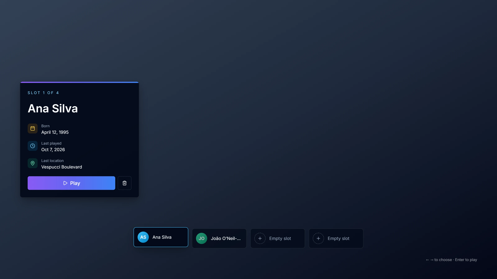
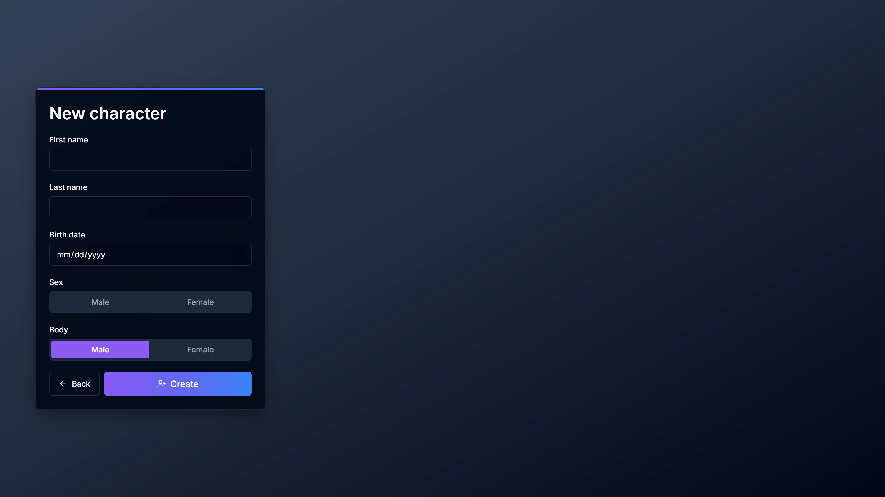
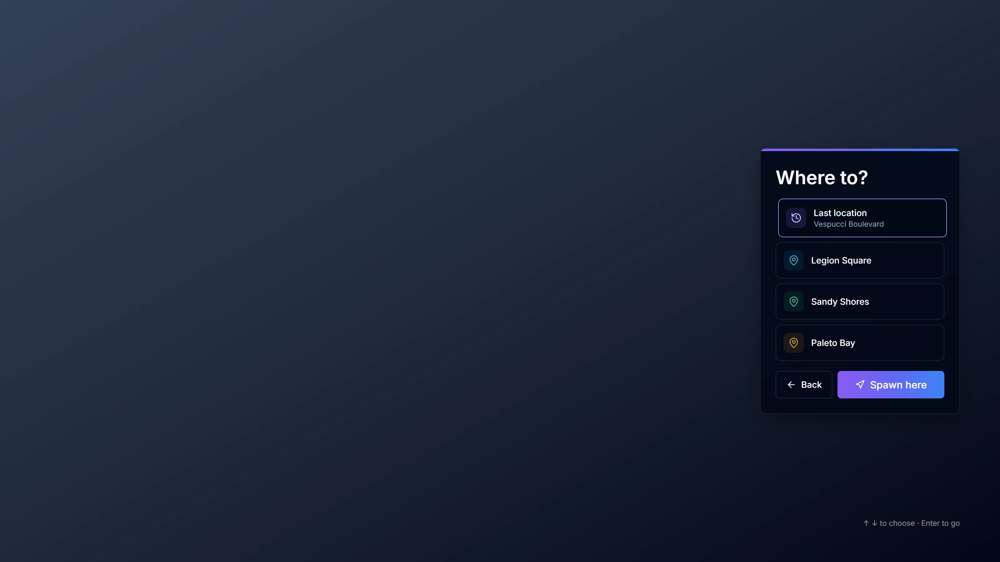

<div align="center">

# ⬢ ug-multicharacter

**Cinematic character selection, creation and spawning for the UgCore Framework.**

[](https://ugcore.urging.ch/ug-multicharacter/introduction)
[](https://github.com/ugcore-project/ug-multicharacter/actions/workflows/ci.yml)
[](https://github.com/ugcore-project/ug-multicharacter/releases/latest)
[](LICENSE)
[](https://discord.gg/pCJUcyVw5X)

[**Documentation**](https://ugcore.urging.ch/ug-multicharacter/introduction) · [**Installation**](https://ugcore.urging.ch/ug-multicharacter/installation) · [**Configuration**](https://ugcore.urging.ch/ug-multicharacter/configuration) · [**Cinematic**](https://ugcore.urging.ch/ug-multicharacter/cinematic)


</div>

---

ug-multicharacter is where players meet their characters. They arrive to an intro over your scene, see their characters standing in a lineup, create new ones, and choose where to spawn with a camera that flies over the city.

The server decides which characters exist, what a new character may be called, where it goes and whether the player got there. The page only shows and asks.

## Features

- 🎬 **Intro.** The screen fades in high over your scene and descends onto the lineup while your server name appears. Enter or Escape skips it.
- 🧍 **Lineup.** Every character stands in its own slot with its own animation. Hovering a card glides the camera to it. Empty slots show a faint figure.
- 📝 **Creation form from your config.** Text, date and select fields, validated the same way on the page and on the server. Names in every language, ages counted to the day.
- 🗺️ **Spawn picker.** The last location and your spawn points. Hovering one flies the camera over it, choosing dives to the ground.
- 🎥 **Nothing snaps.** Every camera move is an eased shot, every cut hides behind a fade.
- 🔒 **Private scene.** Each player chooses in their own routing bucket, so nobody sees anyone else's lineup.
- 💀 **Death state kept.** A downed or dead character goes back where it was, still downed or dead.
- 👕 **Appearance plug-in.** With [ug-appearance](https://github.com/ugcore-project/ug-appearance), creation opens the full creator and the lineup shows every character in its own look. Without it, players pick a body.
- 🔁 **Switch command.** Optionally let players go back to the selection, such as `/logout`.

## Preview

| Selection | Creation | Spawn picker |
| :---: | :---: | :---: |
|  |  |  |

## Requirements

- FXServer with **OneSync**
- [**ug-core**](https://github.com/ugcore-project/ug-core) 1.0.0 or newer, with the **characters** module enabled
- [**ug-lib**](https://github.com/ugcore-project/ug-lib) 1.0.0 or newer
- [**ug-appearance**](https://github.com/ugcore-project/ug-appearance), optional

ug-core's `maxCharacters` MUST NOT be higher than the number of scene slots (4 by default).

Run only one character selection resource. Others that load characters, spawn the player or control spawnmanager conflict with this one.

## Installation

1. Download `ug-multicharacter.zip` from the [latest release](https://github.com/ugcore-project/ug-multicharacter/releases/latest) and extract it into your `resources` folder, for example `resources/[ug]/ug-multicharacter`. The archive holds the built page. To update, extract the new one over it: your `config.lua` stays.

2. Add it to `server.cfg`, last of the UgCore resources:

   ```bash
   ensure oxmysql
   ensure ug-lib
   ensure ug-core
   ensure ug-appearance  # optional
   ensure ug-multicharacter
   ```

3. Start the server. The console prints:

   ```text
   [INFO] Generated config.lua.
   [ug-multicharacter] v1.0.0 ready: 3 spawn points, 4 slots.
   ```

See the [installation guide](https://ugcore.urging.ch/ug-multicharacter/installation) for details.

## Configuration

`config.lua` is yours. It is generated on the first start, never overwritten by updates, and checked on every start: any error is logged with its path, and the resource stays idle instead of half working.

```lua
nameFormat = '{firstName} {lastName}',
ageRange = { min = 18, max = 90 },
spawn = {
    firstSpawn = 'picker',
    points = {
        { id = 'legion', coords = vector4(195.2, -933.8, 30.7, 144.0) },
    },
},
allowDelete = true,
switchCommand = 'logout',
```

### Look and features

| Key | What it changes |
| --- | --- |
| `theme` | ug-lib theme overrides for these screens only. `colors` also takes the accent colors: `violet`, `indigo` and `blue` (the brand gradient), `sky`, `emerald`, `amber`, `rose`, `fuchsia` and `teal` (slots, details, spawn points). Lighter and darker shades follow from the one color. |
| `layout` | `side` of the character panel (`left` or `right`), `slots` bar (`top` or `bottom`), `hint`, `initials` on avatars, `keyboard` (arrows and Enter), `animations`. Keys you leave out keep their default. |
| `details` | Character details on the panel, in order: `born`, `lastPlayed`, `location`. `{}` shows none. |
| `cinematic.skippable` | `false` makes the intro play to the end. The game ignores skip requests too. |
| `soundEffects` | `move`, `select` and `back` game sounds, `{ name, set }`. A sound left out is silent. `sounds = false` mutes them all. |

See [Configuration](https://ugcore.urging.ch/ug-multicharacter/configuration), [Spawning](https://ugcore.urging.ch/ug-multicharacter/spawning) and [Cinematic](https://ugcore.urging.ch/ug-multicharacter/cinematic).

## Console

`ugmc` runs in the server console only.

| Command | Does |
| --- | --- |
| `ugmc status` | Players in the scene, with their phase and for how long. |
| `ugmc reopen <id>` | Saves and unloads the player's character, then sends them back to the selection. |

To send a player back from your own resource, give it the ACE and run `ExecuteCommand(('ugmc reopen %d'):format(source))`:

```bash
add_ace resource.my-resource command.ugmc allow
```

## Project structure

```text
ug-multicharacter/
├── fxmanifest.lua
├── shared/              enums
├── server/              config, characters, spawn checks, player state, commands
├── client/              scene, camera, cinematic, flow, spawn, appearance contract, NUI bridge
├── locales/             en, pt
├── web/                 React page: selection, creation and spawn screens
├── tests/               Lua 5.4 tests with native mocks, never shipped
├── skills/              task guides for AI agents, never shipped
├── AGENTS.md            rules for AI agents and humans
└── CLAUDE.md            points Claude Code to AGENTS.md
```

## Development

Clone ug-core and ug-lib next to this repository: the tests and the type check read them from `../ug-core` and `../ug-lib`, or from the `UG_CORE` and `UG_LIB` paths.

Every change MUST pass these checks. CI runs them on pushes and pull requests to `dev` and `main`.

```bash
# 1. LuaLS strict check, zero problems, with ug-core and ug-lib as libraries
lua-language-server --check . --checklevel=Information --configpath=.luarc.json

# 2. Runtime tests
for suite in tests/*.lua; do [ "$suite" = tests/helpers.lua ] || lua5.4 "$suite" || exit 1; done

# 3. Manifest and license headers
lua5.4 .github/scripts/check-repository.lua
```

The page needs Node.js 20.19 or newer:

```bash
cd web
npm ci
npm run lint && npm run typecheck && npm test
npm run build && npm run budget   # web/dist, at most 400 KB gzipped
npm run dev                       # browser preview with buttons that play the showcase scenes
npm run capture                   # README images from the scenes, to .github/assets
```

The README images come from the scenes in `web/src/dev/scenes.ts`: see [skills/readme-preview](skills/readme-preview/SKILL.md).

For editor support, install the [Lua](https://marketplace.visualstudio.com/items?itemName=sumneko.lua) and [CfxLua](https://marketplace.visualstudio.com/items?itemName=overextended.cfxlua-vscode) VS Code extensions.

### Conventions

- Lua 5.4. Every file starts with the license header. Every function has LuaLS annotations.
- Net events and callbacks go through ug-core with a schema and a rate limit. Clients send intent, never results. Never read a player's identity from event arguments.
- Magic values live in `UgMc.Enums`. NUI enums MUST match `web/src/types/protocol.ts`: `tests/nui.lua` fails when they differ.
- Defaults live in `server/config.default.lua` only, with a comment owners understand.
- Every player-facing text goes through `locales/`. Every locale file has the same keys as `en.json`.

### Working with AI agents

[AGENTS.md](AGENTS.md) holds the conventions and security rules every agent MUST follow. Claude Code reads it through
`CLAUDE.md`; Codex, Cursor and others read `AGENTS.md` directly. Task guides:

| Skill | For |
| --- | --- |
| [server-actions](skills/server-actions/SKILL.md) | Callbacks and net events |
| [nui-page](skills/nui-page/SKILL.md) | The page, its messages and callbacks |
| [config](skills/config/SKILL.md) | Owner config options |
| [testing](skills/testing/SKILL.md) | Lua and web tests |
| [readme-preview](skills/readme-preview/SKILL.md) | README features and images |
| [ug-core-api](skills/ug-core-api/SKILL.md) | What ug-core and ug-lib offer |

### Releases

Releases are automated. release-please keeps a `chore: release X.Y.Z` pull request open on `main` that bumps
`version` in `fxmanifest.lua` and `CHANGELOG.md` from Conventional Commits. Merging it tags `vX.Y.Z`, builds the page
and attaches `ug-multicharacter.zip` with only what a server runs. Every push to `dev` replaces the `dev-build` pre-release.
Merge `dev` into `main` with a merge commit, never squash. Commit subjects become the changelog: write them for owners.

## Contributing

Contributions are welcome. Branch off `dev` and open a pull request to `dev`.

- Commits and PR titles follow [Conventional Commits](https://www.conventionalcommits.org): lowercase imperative subject, no trailing period, 72 characters at most. Scopes: `core`, `scene`, `camera`, `nui`, `web`, `spawn`, `create`, `delete`, `appearance`, `config`, `locale`, `ci`, `deps`.
- Add or extend a test for every change in behavior.
- Translations are welcome: copy `locales/en.json` to your language code and translate the values.

Read the [contributing guide](https://github.com/ugcore-project/.github/blob/main/CONTRIBUTING.md) and the [Code of Conduct](https://github.com/ugcore-project/.github/blob/main/CODE_OF_CONDUCT.md).

## Security

Never report a vulnerability in a public issue. [Report it privately](https://github.com/ugcore-project/ug-multicharacter/security/advisories/new) and read the [Security Policy](https://github.com/ugcore-project/.github/blob/main/SECURITY.md).

## License

ug-multicharacter is free software, licensed under the [GNU General Public License v3.0](LICENSE).

Copyright (C) 2026 UgCore Framework & Contributors.
